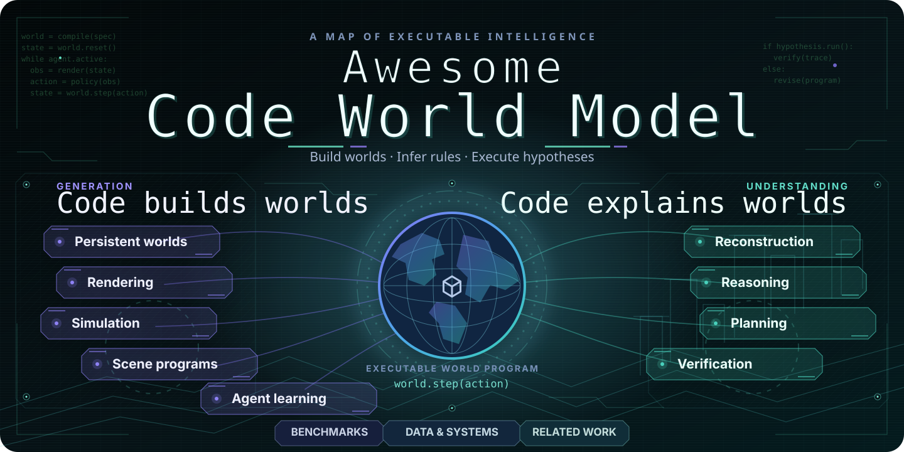

<div align="center">
<h1>📜 Awesome Code World Model</h1>
<p><b>Executable worlds, organized by the research questions they answer.</b></p>

<p><b>Code builds worlds. Code explains worlds.</b></p>
<p><a href="site/index.html"></a></p>
<p>Search papers · Filter mechanisms · Compare work · Explore benchmarks</p>
<p><b>60 papers &amp; projects</b> · <b>23 benchmark suites</b> · <b>8 comparison dimensions</b><br>Sources checked 2026-10-23</p>
<p><a href="#overview">Research map</a> · <a href="#benchmarks">Benchmark atlas</a> · <a href="docs/TAXONOMY.md">Taxonomy</a> · <a href="CONTRIBUTING.md">Contribute</a></p>
</div>

---

<table width="100%">
<tr>
<td align="center">🌟 <b>Representative</b></td>
<td align="center">✅ <b>Public resources</b></td>
<td align="center">❌️ <b>Resources not found</b></td>
</tr>
</table>

**Legend.** 🌟 Representative work appears first and in bold. ✅ links public code, data, weights or a project page; it does not certify an open-source license. Dates use first submission; unknown releases remain `Date TBC`.

---

<a id="news-updates"></a>

## 🚩 News & Updates

📚 **[2026-10-23] Two New Papers** — Added HARMONY for single-image scene reconstruction and VibeWorlding for 3D world construction.

🧭 **[2026-10-23] Research Map & README Refresh** — Separated interaction from streaming delivery; narrowed executable verification to methods, with benchmarks indexed by task. Refreshed the visual research map and compact reading index. All 58 records are retained.

<details>
<summary>Earlier collection updates</summary>

📊 **[2026-10-21] Benchmark Atlas & Infrastructure** — Added 14 works, including 4DCodeBench, BVB, BlenderWorld, PhysCodeGym, PhySimCode, ExeWorldBench, WorldStream and H3 Streaming VAE Decoder. Named benchmark suites now have task, artifact and evaluation indexes; 3DCodeVerse data and harness resources are linked.

🔥 **[2026-10-21] Initial Collection** — 44 papers and projects covering Code World Model (generation) and Code as Model (understanding), including earlier foundations and the latest October releases.

🗂️ **[2026-10-21] Research Taxonomy** — Nine core research categories, two related perspectives, and seven comparison dimensions. Representative works are highlighted with 🌟.

🤖 **[2026-10-21] Daily Discovery Prototype** — Daily arXiv and GitHub discovery is implemented as a candidate-review workflow. Automated promotion and a full literature-review agent remain future work.

</details>


<a id="recent-paper-updates"></a>

## 🔥 Recent Paper Updates

[2026-10-21] ✅[VibeWorlding: Can Multimodal Agents Construct 3D Open Worlds End-to-End?](https://arxiv.org/abs/2608.15265)

[2026-10-21] ✅[HARMONY: Hierarchical Agentic Reasoning for MONocular Image-to-Scene Synthesis](https://arxiv.org/abs/2609.26793)

[2026-10-20] ✅[SolarRenderer: Few-Step Generative Reference Rendering](https://arxiv.org/abs/2610.28630)

[2026-10-20] ❌️[NeoWorld-3: From Pixels to Code-Defined Physical Worlds](https://arxiv.org/abs/2610.27690)

[2026-10-20] ✅[Matrix-Game 4.0: Harnessing Video Models for Real-Time Playable Game Worlds](https://arxiv.org/abs/2610.27999)

[2026-10-19] ❌️[From Code to Playable Systems: CEGame-Bench for Long-Horizon Game Creation Agents](https://arxiv.org/abs/2610.26098)

<details>
<summary>More recent papers & projects with unconfirmed dates</summary>

[2026-10-18] ❌️[LLM Agents as Suppliers of Physical System Models: Calibration and Acceptance in Modelica](https://arxiv.org/abs/2610.25019)

[2026-10-15] ✅[Mallea: Building, Steering, and Memorizing Worlds with Coding Agent](https://arxiv.org/abs/2610.21283)

[2026-10-15] ✅[3DCodeVerse: Exploring 3D Worlds as Code](https://arxiv.org/abs/2610.22341)

[2026-10-14] ✅[BlenderWorld: Benchmarking Visual Agents for 3D Creation from Real-World References](https://arxiv.org/abs/2610.23986)

[2026-10-13] ✅[RoboSimStudio: An Interactive Toolkit for Human and Agent Rapid Real2Sim of Robot Manipulation Tasks](https://arxiv.org/abs/2610.18835)

[2026-10-13] ✅[Code2Worlds-2: Physically Plausible Agent Harness for Embodied World Simulation](https://arxiv.org/abs/2610.17651)

[2026-10-12] ✅[PhysCodeGym: Benchmarking Coding Agents for Physically Verifiable 4D Reconstruction](https://arxiv.org/abs/2610.17288)

[2026-10-11] ✅[PhySimCode: A Benchmark and Evaluation Method for Physics Video to Code Generation](https://arxiv.org/abs/2610.15722)

[2026-10-11] ❌️[ANTE: Anticipate, Then Execute -- Learning Internal World Models for Coding Agents from Verified Beliefs](https://arxiv.org/abs/2610.15368)

[2026-10-10] ✅[ExeWorldBench: Benchmarking Code-Based Executable 3D World Modeling](https://arxiv.org/abs/2610.15166)

[2026-10-08] ✅[AgentGarten: Code Worlds for Evolving Agents](https://arxiv.org/abs/2610.12374)

[2026-10-06] ✅[WorldSolver: Can LLM Agents Simulate the Physical Dynamics via Solver Generation?](https://arxiv.org/abs/2610.08720)

[2026-10-03] ✅[Video2World: Benchmarking Coding Agents for Interactive World Modeling from Embodied Videos](https://arxiv.org/abs/2610.04432)

[2026-10-02] ✅[4DCodeBench: Benchmarking Agents on Inverse Graphics of Dynamic Scenes](https://arxiv.org/abs/2610.03715)

**Official projects with unconfirmed first-release dates**

[Date TBC] ✅[WorldStream: Building 3D Worlds as You Explore](https://krennic999.github.io/WorldStream/blog/)

[Date TBC] ✅[StreamRender-H3: Interactive Coding Worlds with Real-time Streaming Diffusion Render](https://nvlabs.github.io/Sana/Sol-Engine/StreamRender-H3/)

[Date TBC] ✅[Streaming Code World Model](https://github.com/TingtingLiao/streaming-code-world-model)

[Date TBC] ✅[H3 Streaming VAE Decoder: Training-Free Streaming without Future Latents](https://solarx-team.github.io/H3-Streaming-VAE-Decoder/)

[Date TBC] ✅[Code Video Model](https://code-video-model.github.io/tech_report.pdf)

</details>

---

<a id="overview"></a>

## 🧭 Overview

Two reading directions share one executable representation. Choose a research question below; use the benchmark and infrastructure indexes for reusable resources.

<table width="100%">
<tr>
<td width="50%" valign="top"><b><a href="#code-world-model">💻 Code World Model · Generation</a></b><br>Intent → program → world<br><br><a href="#g-hybrid">🎮 Persistent &amp; playable worlds</a><br><a href="#g-rendering">🎬 Code-guided video &amp; rendering</a><br><a href="#g-simulation">⚙️ Physical simulation synthesis</a><br><a href="#g-scene">🏗️ Scene &amp; asset programs</a><br><a href="#g-learning">🌱 Worlds for agent learning</a></td>
<td width="50%" valign="top"><b><a href="#code-as-model">🧠 Code as Model · Understanding</a></b><br>Observation → program → explanation<br><br><a href="#u-inverse">🔄 Inverse world reconstruction</a><br><a href="#u-reasoning">🧪 Executable physical reasoning</a><br><a href="#u-planning">🧩 Rule induction &amp; planning</a><br><a href="#u-verification">📏 Executable verification</a></td>
</tr>
<tr><td colspan="2" align="center"><a href="#benchmarks">📊 Benchmarks &amp; Evaluation</a> · <a href="#infrastructure">🛠️ Datasets &amp; Systems</a> · <a href="#related-perspectives">🔎 Related Perspectives</a><br><a href="#reading-guide">Reading paths &amp; dimensions</a> · <a href="#citation">Citation</a></td></tr>
</table>

Each work appears once in the main research list, under its primary contribution. Cross-category associations remain searchable in the website. [Classification rationale](docs/TAXONOMY.md).


---

<a id="code-world-model"></a>

## 💻 Code World Model · Generation

Intent → executable state and rules → observations and interaction.


<a id="g-hybrid"></a>

### 🎮 Persistent & playable worlds

Who owns state, rules and consequences outside the current frame?

**[2026-08] ✅🌟(Persistent world state with proxy-conditioned generative observations) [Code World Model: Coding Agent as World Brain](https://arxiv.org/abs/2608.25927) · [Code](https://github.com/buaacyw/code-world-model) · [Project](https://buaacyw.github.io/cwm/)**

[2026-10] ✅[Matrix-Game 4.0: Harnessing Video Models for Real-Time Playable Game Worlds](https://arxiv.org/abs/2610.27999) · [Project](https://matrix-game-v4-0.github.io/page/)

[2026-10] ❌️[From Code to Playable Systems: CEGame-Bench for Long-Horizon Game Creation Agents](https://arxiv.org/abs/2610.26098)

[2026-10] ✅[Mallea: Building, Steering, and Memorizing Worlds with Coding Agent](https://arxiv.org/abs/2610.21283) · [Project](https://lxycopper.github.io/Mallea)

[2026-10] ✅[World Editing: Intervening on Executable Worlds at Increasing Depth](https://arxiv.org/abs/2610.02331) · [Code](https://github.com/vinesmsuic/IGMWorld/) · [Project](https://vinesmsuic.github.io/IGMWorld/)

[2026-09] ✅[GameDirector: Decoupling Gameplay Logic from Rendering for Player-Configurable Game World Models](https://arxiv.org/abs/2609.25652) · [Project](https://jimntu.github.io/gamedirector/)

[2026-09] ✅[Code Plans, Diffusion Renders: Open-Ended Generative World Modeling](https://arxiv.org/abs/2609.26458) · [Project](https://becauseimbatman0.github.io/CoDeR)

[2026-09] ✅[Programmable World Model](https://arxiv.org/abs/2609.10540) · [Project](https://alaya-lab.github.io/pwm) · [Code](https://github.com/AlayaLab/pwm)

[Date TBC] ✅[WorldStream: Building 3D Worlds as You Explore](https://krennic999.github.io/WorldStream/blog/) · [Project](https://github.com/krennic999/WorldStream) · [Project](https://krennic999.github.io/WorldStream/)


<a id="g-rendering"></a>

### 🎬 Code-guided video & rendering

How does executable structure control appearance over time?

**[2026-07] ✅🌟(Executable Blender code as process-level chain of thought) [VideoCoCo: Code-as-CoT for Physically-Consistent Video Generation via an Agentic Dual-Engine System](https://arxiv.org/abs/2607.27380) · [Code](https://github.com/micky-li-hd/VideoCoCo)**

[2026-10] ✅[SolarRenderer: Few-Step Generative Reference Rendering](https://arxiv.org/abs/2610.28630) · [Project](https://enderfga.cn/SolarRenderer) · [Code](https://github.com/Enderfga/SolarRenderer)

[Date TBC] ✅[StreamRender-H3: Interactive Coding Worlds with Real-time Streaming Diffusion Render](https://nvlabs.github.io/Sana/Sol-Engine/StreamRender-H3/) · [Code](https://github.com/NVlabs/Sana/tree/sol-engine/models/streamrender_h3)

[Date TBC] ✅[Streaming Code World Model](https://github.com/TingtingLiao/streaming-code-world-model) · [Weights](https://huggingface.co/Luffuly/streaming-code-world-model)

[Date TBC] ✅[Code Video Model](https://code-video-model.github.io/tech_report.pdf) · [Project](https://code-video-model.github.io/) · [Code](https://github.com/code-video-model/CodeVideoModel) · [Data](https://huggingface.co/datasets/code-video-model/CodeVideoBench)


<a id="g-simulation"></a>

### ⚙️ Physical simulation synthesis

Does generated code instantiate working physical mechanisms?

**[2026-02] ✅🌟(Language-to-code generation of dynamic 4D worlds) [Code2Worlds: Empowering Coding LLMs for 4D World Generation](https://arxiv.org/abs/2602.11757) · [Code](https://github.com/AIGeeksGroup/Code2Worlds) · [Project](https://aigeeksgroup.github.io/Code2Worlds)**

[2026-10] ✅[Code2Worlds-2: Physically Plausible Agent Harness for Embodied World Simulation](https://arxiv.org/abs/2610.17651) · [Code](https://github.com/AIGeeksGroup/Code2Worlds-2) · [Project](https://aigeeksgroup.github.io/Code2Worlds-2)

[2026-10] ✅[ExeWorldBench: Benchmarking Code-Based Executable 3D World Modeling](https://arxiv.org/abs/2610.15166) · [Project](https://helen1p.github.io/ExeWorldBench/) · [Project](https://github.com/Helen1p/ExeWorldBench) · [Data](https://huggingface.co/datasets/HelenPeng/ExeWorldBench)

[2026-09] ❌️[Text2Sim: Agentic Physics-Based Simulation Generation with Distilled Expertise](https://arxiv.org/abs/2609.36593)

[2026-09] ❌️[GPUPhysBench: Benchmarking Coding Agents for Correct and Efficient GPU Physics Simulation](https://arxiv.org/abs/2609.35639)

[2026-09] ❌️[WorldAgent: Verification-Guided Agentic Physical World Construction](https://arxiv.org/abs/2609.33208)

[2026-07] ✅[GS-Agent: Creating 4D Physical Worlds With Generative Simulation](https://arxiv.org/abs/2607.21522) · [Project](https://umass-embodied-agi.github.io/gs-agent/)

[2026-07] ✅[SimWorlds: A Multi-Agent System for Dynamic 3D Scene Creation](https://arxiv.org/abs/2607.01766) · [Project](https://dynsimworlds.github.io)


<a id="g-scene"></a>

### 🏗️ Scene & asset programs

Can a scene be edited, composed and loaded into a simulator?

[2026-10] ✅[3DCodeVerse: Exploring 3D Worlds as Code](https://arxiv.org/abs/2610.22341) · [Project](https://3dcodeverse.com/) · [Code](https://github.com/gaoypeng/3dcodeverse) · [Data](https://huggingface.co/datasets/ilabai/3dcodeverse)

[2026-10] ✅[BlenderWorld: Benchmarking Visual Agents for 3D Creation from Real-World References](https://arxiv.org/abs/2610.23986) · [Code](https://github.com/QwenLM/BlenderWorld) · [Project](https://blenderworld.github.io/) · [Data](https://huggingface.co/datasets/Qwen/BlenderWorld)

[2026-09] ✅[Code4Scene: Benchmarking Coding Agents for Constructing and Editing 3D Scenes](https://arxiv.org/abs/2609.36777) · [Code](https://github.com/SimWorld-AI/Code4Scene) · [Project](https://simworld-ai-code4scene.static.hf.space)

[2026-08] ✅[VibeWorlding: Can Multimodal Agents Construct 3D Open Worlds End-to-End?](https://arxiv.org/abs/2608.15265) · [Project](https://usail-hkust.github.io/VibeWorlding-Gym/) · [Code](https://github.com/usail-hkust/VibeWorlding-Gym) · [Data](https://huggingface.co/datasets/usail-hkust/VWE-Bench) · [Weights](https://huggingface.co/collections/usail-hkust/vibeworlder)

[2026-05] ✅[3DCodeBench: Benchmarking Agentic Procedural 3D Modeling Via Code](https://arxiv.org/abs/2606.01057) · [Code](https://github.com/gaoypeng/3dcodebench) · [Project](https://www.3dcodebench.com/) · [Data](https://huggingface.co/datasets/YipengGao/3DCode)

[2026-05] ✅[SceneCode: Executable World Programs for Editable Indoor Scenes with Articulated Objects](https://arxiv.org/abs/2605.19587) · [Project](https://scene-code.github.io/)

[2025-04] ✅[BlenderGym: Benchmarking Foundational Model Systems for Graphics Editing](https://arxiv.org/abs/2504.01786) · [Code](https://github.com/richard-guyunqi/BlenderGym-Open) · [Project](https://blendergym.github.io/) · [Data](https://huggingface.co/datasets/richard-guyunqi/BG_bench_data)

[2024-03] ❌️[SceneCraft: An LLM Agent for Synthesizing 3D Scene as Blender Code](https://arxiv.org/abs/2403.01248)


<a id="g-learning"></a>

### 🌱 Worlds for agent learning

Can generated environments grow with an agent's capabilities?

**[2023-11] ✅🌟(The propose–generate–learn loop for generative simulation) [RoboGen: Towards Unleashing Infinite Data for Automated Robot Learning via Generative Simulation](https://arxiv.org/abs/2311.01455) · [Code](https://github.com/Genesis-Embodied-AI/RoboGen) · [Project](https://robogen-ai.github.io/)**

[2026-10] ✅[AgentGarten: Code Worlds for Evolving Agents](https://arxiv.org/abs/2610.12374) · [Project](https://mirros-lab.github.io/agent-garten)

[2026-05] ❌️[SimWorld Studio: Automatic Environment Generation with Evolving Coding Agent for Embodied Agent Learning](https://arxiv.org/abs/2605.09423)

[2024-09] ✅[FactorSim: Generative Simulation via Factorized Representation](https://arxiv.org/abs/2409.17652) · [Project](https://cs.stanford.edu/~sunfanyun/factorsim/)


---

<a id="code-as-model"></a>

## 🧠 Code as Model · Understanding

Observations → executable hypotheses → prediction, intervention and verification.


<a id="u-inverse"></a>

### 🔄 Inverse world reconstruction

Which program and parameters explain the observations?

**[2026-06] ✅🌟(Code vs. video diffusion for inverse physics and stable extrapolation) [MPMWorlds: Material-Point-Method Simulations for Inferring and Extrapolating Physical Dynamics](https://arxiv.org/abs/2606.01538) · [Project](https://zzigak.github.io/mpmworlds/)**

[2026-10] ❌️[NeoWorld-3: From Pixels to Code-Defined Physical Worlds](https://arxiv.org/abs/2610.27690)

[2026-10] ❌️[LLM Agents as Suppliers of Physical System Models: Calibration and Acceptance in Modelica](https://arxiv.org/abs/2610.25019)

[2026-10] ✅[RoboSimStudio: An Interactive Toolkit for Human and Agent Rapid Real2Sim of Robot Manipulation Tasks](https://arxiv.org/abs/2610.18835) · [Project](https://robosimstudio.github.io)

[2026-10] ✅[PhysCodeGym: Benchmarking Coding Agents for Physically Verifiable 4D Reconstruction](https://arxiv.org/abs/2610.17288) · [Code](https://github.com/ShaoShuai0605/PhysCodeGym) · [Data](https://huggingface.co/datasets/ShaoShuai0605/PhysCodeGym)

[2026-10] ✅[PhySimCode: A Benchmark and Evaluation Method for Physics Video to Code Generation](https://arxiv.org/abs/2610.15722) · [Code](https://github.com/SourajaKundu/PhySimCode) · [Project](https://sourajakundu.github.io/PhySimCode/) · [Data](https://huggingface.co/datasets/SourajaKundu123/PhySimCode)

[2026-10] ✅[Video2World: Benchmarking Coding Agents for Interactive World Modeling from Embodied Videos](https://arxiv.org/abs/2610.04432) · [Project](https://aetherlabsai.github.io/Video2World) · [Code](https://github.com/AetherLabsAI/Video2World) · [Data](https://huggingface.co/datasets/AetherLabs-AI/Video2World)

[2026-10] ✅[4DCodeBench: Benchmarking Agents on Inverse Graphics of Dynamic Scenes](https://arxiv.org/abs/2610.03715) · [Code](https://github.com/4DCodeBench/4DCodeBench) · [Project](https://4dcodebench.com/) · [Data](https://huggingface.co/datasets/4DCodeBench/Dataset-Real-World) · [Data](https://huggingface.co/datasets/4DCodeBench/Dataset-Synthetic)

[2026-09] ✅[HARMONY: Hierarchical Agentic Reasoning for MONocular Image-to-Scene Synthesis](https://arxiv.org/abs/2609.26793) · [Project](https://cwchenwang.github.io/harmony/) · [Code](https://github.com/ShufanSun/harmony-release) · [Data](https://huggingface.co/datasets/ShufanSun/harmony)

[2026-09] ✅[BVB: Benchmarking Agentic Video Understanding via Programmatic Reconstruction in Blender](https://arxiv.org/abs/2609.15478) · [Code](https://github.com/yunlong10/BVB) · [Project](https://yoloytang.me/BVB/)

[2026-09] ❌️[Recursive Code World Models: Building Complex Worlds through Recursive Scene Programs](https://arxiv.org/abs/2609.11499)


<a id="u-reasoning"></a>

### 🧪 Executable physical reasoning

Does running a hypothesis support quantitative predictions and interventions?

**[2026-08] ✅🌟(Executable world hypotheses for quantitative physical reasoning) [Code as Worlds: Agentic Discovery of Executable World Representations for Physical Reasoning](https://arxiv.org/abs/2608.27549) · [Project](https://mirros-lab.github.io/code-as-world)**

[2026-10] ✅[WorldSolver: Can LLM Agents Simulate the Physical Dynamics via Solver Generation?](https://arxiv.org/abs/2610.08720) · [Code](https://github.com/sirujiang/WorldSolver)


<a id="u-planning"></a>

### 🧩 Rule induction & planning

Is the inferred transition function useful for choosing actions?

**[2024-05] ✅🌟(Program-synthesis search for executable transition models) [Generating Code World Models with Large Language Models Guided by Monte Carlo Tree Search](https://arxiv.org/abs/2405.15383) · [Project](https://sites.google.com/view/code-world-models/home)**

**[2019-12] ❌️🌟(Early world-program formulation for compositional planning) [World Programs for Model-Based Learning and Planning in Compositional State and Action Spaces](https://arxiv.org/abs/1912.13007)**

[2026-07] ✅[VisualPatchWorld: Code World Models as Latent Structured Representations for Planning](https://arxiv.org/abs/2607.25236) · [Code](https://github.com/HKBU-KnowComp/VisualPatchWorld/)

[2025-10] ❌️[Code World Models for General Game Playing](https://arxiv.org/abs/2510.04542)


<a id="u-verification"></a>

### 📏 Executable verification

Which executable checks can accept, reject or qualify a world hypothesis?

[2026-09] ❌️[VeriPhy: Agentic Physical Reasoning for World Model Evaluation and Refinement](https://arxiv.org/abs/2609.03153)


---

<a id="benchmarks"></a>

## 📊 Benchmarks & Evaluation

Compare the task, submitted artifact and evidence of success. These suites test different capabilities; their scores are not interchangeable.

**[Open the Benchmark Atlas →](docs/BENCHMARKS.md)** for inputs, submitted artifacts, evaluation evidence and version caveats. Suite names below link to their sources; method papers are counted only once.

| Research task | Suites / resources |
| --- | --- |
| Video reconstruction & inverse graphics | [PhysCodeGym](https://github.com/ShaoShuai0605/PhysCodeGym) · [Video2World](https://aetherlabsai.github.io/Video2World) · [4DCodeBench](https://github.com/4DCodeBench/4DCodeBench) · [BVB / Blender-VideoBench](https://yoloytang.me/BVB/) |
| Procedural 3D creation & scene editing | [Code4D](https://arxiv.org/abs/2602.11757) · [BlenderWorld](https://github.com/QwenLM/BlenderWorld) · [Code4Scene](https://arxiv.org/html/2609.36777v1) · [HARMONY300](https://github.com/ShufanSun/harmony-release#evaluation) · [VWE-Bench](https://arxiv.org/html/2608.15265v2) · [4DBuildBench](https://arxiv.org/abs/2607.01766) · [3DCodeBench / 3DCodeArena](https://www.3dcodebench.com/) · [BlenderGym](https://arxiv.org/html/2504.01786v1) |
| Physical mechanisms, parameters & solvers | [MPMWorlds](https://arxiv.org/abs/2606.01538) · [PhysCodeGym](https://github.com/ShaoShuai0605/PhysCodeGym) · [PhySimCode](https://github.com/SourajaKundu/PhySimCode) · [ExeWorldBench](https://arxiv.org/abs/2610.15166) · [WorldSolver](https://arxiv.org/abs/2610.08720) · [GPUPhysBench](https://arxiv.org/html/2609.35639v1) · [4DBuildBench](https://arxiv.org/abs/2607.01766) |
| Executable interaction, state & intervention | [Code World Models Benchmark (CWMB)](https://arxiv.org/abs/2405.15383) · [CEGame-Bench](https://arxiv.org/abs/2610.26098) · [SimCode4D](https://arxiv.org/abs/2610.17651) · [ExeWorldBench](https://arxiv.org/abs/2610.15166) · [Video2World](https://aetherlabsai.github.io/Video2World) · [IGMBench](https://vinesmsuic.github.io/IGMWorld/) · [CombatStateBench](https://arxiv.org/abs/2609.10540) |
| Code-guided video generation | [CodeVideoBench](https://code-video-model.github.io/) |


---

<a id="infrastructure"></a>

## 🛠️ Datasets, Harnesses & Streaming Systems

Reusable code corpora, construction workflows and systems that deliver persistent worlds or streaming pixels.

| Research task | Suites / resources |
| --- | --- |
| Executable code & simulation corpora | [MPMWorlds](https://arxiv.org/abs/2606.01538) · [3DCodeVerse](https://3dcodeverse.com/) · [PhySimCode](https://github.com/SourajaKundu/PhySimCode) · [3DCodeBench / 3DCodeArena](https://www.3dcodebench.com/) |
| Construction & verification harnesses | [3DCodeVerse](https://3dcodeverse.com/) · [Code2Worlds-2](https://arxiv.org/abs/2610.17651) · [AgentGarten](https://arxiv.org/abs/2610.12374) · [Text2Sim](https://arxiv.org/abs/2609.36593) · [WorldAgent](https://arxiv.org/abs/2609.33208) · [HARMONY](https://cwchenwang.github.io/harmony/) · [VeriPhy](https://arxiv.org/abs/2609.03153) · [VibeWorlding](https://github.com/usail-hkust/VibeWorlding-Gym) · [SimWorlds](https://arxiv.org/abs/2607.01766) |
| Streaming worlds, renderers & decoders | [SolarRenderer](https://arxiv.org/abs/2610.28630) · [Matrix-Game 4.0](https://arxiv.org/abs/2610.27999) · [WorldStream](https://krennic999.github.io/WorldStream/blog/) · [StreamRender-H3](https://nvlabs.github.io/Sana/Sol-Engine/StreamRender-H3/) · [Streaming Code World Model](https://github.com/TingtingLiao/streaming-code-world-model) · [H3 Streaming VAE Decoder](https://solarx-team.github.io/H3-Streaming-VAE-Decoder/) |


---

<a id="related-perspectives"></a>

## 🔎 Related Perspectives

Neighboring work clarifies the scope: software execution, non-program representations and decoder components.


<a id="a-software"></a>

### 💻 Software execution worlds

Is code the environment being predicted rather than a physical world representation?

[2026-10] ❌️[ANTE: Anticipate, Then Execute -- Learning Internal World Models for Coding Agents from Verified Beliefs](https://arxiv.org/abs/2610.15368)

[2026-02] ❌️[Debugging code world models](https://arxiv.org/abs/2602.07672)

[2026-02] ✅[SWE-World: Building Software Engineering Agents in Docker-Free Environments](https://arxiv.org/abs/2602.03419) · [Code](https://github.com/RUCAIBox/SWE-World)

[2025-09] ✅[CWM: An Open-Weights LLM for Research on Code Generation with World Models](https://arxiv.org/abs/2510.02387) · [Code](https://github.com/facebookresearch/cwm)


<a id="a-representation"></a>

### 💬 Alternative representations

What can language, constraints or neural priors supply without synthesized world code?

[2026-09] ❌️[Physis-Lang: Self-Evolving Language as a Physical Representation for Video World Model](https://arxiv.org/abs/2609.40358)

[2024-04] ✅[PhysDreamer: Physics-Based Interaction with 3D Objects via Video Generation](https://arxiv.org/abs/2404.13026) · [Project](https://physdreamer.github.io/)

[2023-12] ✅[Holodeck: Language Guided Generation of 3D Embodied AI Environments](https://arxiv.org/abs/2312.09067) · [Code](https://github.com/allenai/Holodeck) · [Project](https://yueyang1996.github.io/holodeck/)


<a id="a-streaming"></a>

### ⚡ Streaming decoder infrastructure

When can pixels be emitted after a latent arrives?

[Date TBC] ✅[H3 Streaming VAE Decoder: Training-Free Streaming without Future Latents](https://solarx-team.github.io/H3-Streaming-VAE-Decoder/) · [Code](https://github.com/SolarX-Team/H3-Streaming-VAE-Decoder)


---

<a id="reading-guide"></a>

## 🧭 Reading Guide & Taxonomy

Research categories describe the main question. Benchmarks and infrastructure describe reusable contributions. Comparison dimensions describe mechanisms; they are multi-label facets, not a ranking.

| Dimension | What to compare |
| --- | --- |
| Role of code | What does the code actually do? |
| World representation | Where is the inspectable state? |
| Dynamics authority | What determines the next state? |
| Refinement signal | What signal refines the program or model, during construction or training? |
| Interaction contract | What can a user or agent change? |
| Delivery mode | How is the world or its observations delivered? |
| Evaluation target | What has the paper chosen to measure? |
| Domain | Which world is being modeled? |

Streaming delivery does not establish real-time control. Public resources do not establish an open-source license. [Full taxonomy and scope boundaries →](docs/TAXONOMY.md)

- **From code to pixels**: [VideoCoCo](https://arxiv.org/abs/2607.27380) → [Code World Model](https://arxiv.org/abs/2608.25927) → [Programmable World Model](https://arxiv.org/abs/2609.10540) → [Code Video Model](https://code-video-model.github.io/) → [SolarRenderer](https://arxiv.org/abs/2610.28630) → [Matrix-Game 4.0](https://arxiv.org/abs/2610.27999)
- **From observation to mechanism**: [GIF-MCTS / CWMB](https://arxiv.org/abs/2405.15383) → [MPMWorlds](https://arxiv.org/abs/2606.01538) → [Code as Worlds](https://arxiv.org/abs/2608.27549) → [Video2World](https://arxiv.org/abs/2610.04432) → [NeoWorld-3](https://arxiv.org/abs/2610.27690)
- **From plausible to executable**: [Code2Worlds](https://arxiv.org/abs/2602.11757) → [SimWorlds](https://arxiv.org/abs/2607.01766) → [Text2Sim](https://arxiv.org/abs/2609.36593) → [WorldAgent](https://arxiv.org/abs/2609.33208) → [Code2Worlds-2](https://arxiv.org/abs/2610.17651) → [WorldSolver](https://arxiv.org/abs/2610.08720)
- **Worlds that train agents**: [RoboGen](https://arxiv.org/abs/2311.01455) → [FactorSim](https://arxiv.org/abs/2409.17652) → [SimWorld Studio](https://arxiv.org/abs/2605.09423) → [AgentGarten](https://arxiv.org/abs/2610.12374)


<a id="citation"></a>

## 📝 Citation

Please cite the original papers. Download [all BibTeX entries](site/papers.bib), or copy individual citations from the website.

## Contributing & Maintenance

Missing a paper or a resource? See [CONTRIBUTING.md](CONTRIBUTING.md). Source checks and naming boundaries are documented in [Research notes](docs/RESEARCH.md).

<details>
<summary>Local preview & maintenance</summary>

`data/papers.json` stores the literature; `data/taxonomy.json` defines categories and dimensions. Edit `docs/README.template.md` and `scripts/build.py` to change this generated README.

```bash
python3 scripts/build.py
python3 -m unittest discover -s tests -v
python3 -m http.server 8000 --directory site
```

Open `http://localhost:8000`, or open `site/index.html` directly. [GitHub Pages setup](docs/DEPLOYMENT.md) · [Daily discovery workflow](docs/CRAWLER_HANDOFF.md) · [JSON](data/papers.json) · [CSV](site/papers.csv).

</details>

## Acknowledgments & License

Visual hierarchy and paper-list conventions take inspiration from [Awesome Interactive World Model](https://github.com/EasonTuT/Awesome-Interactive-World-Model). The research taxonomy, editorial notes, vector artwork and implementation are maintained independently.

Repository code and original editorial content: [MIT](LICENSE). Papers and external resources belong to their respective authors and providers.
